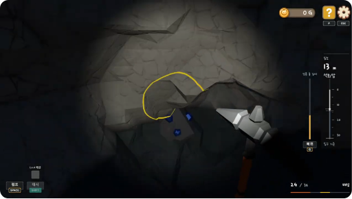
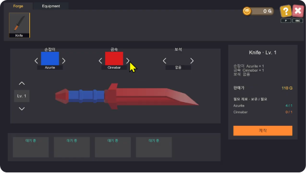
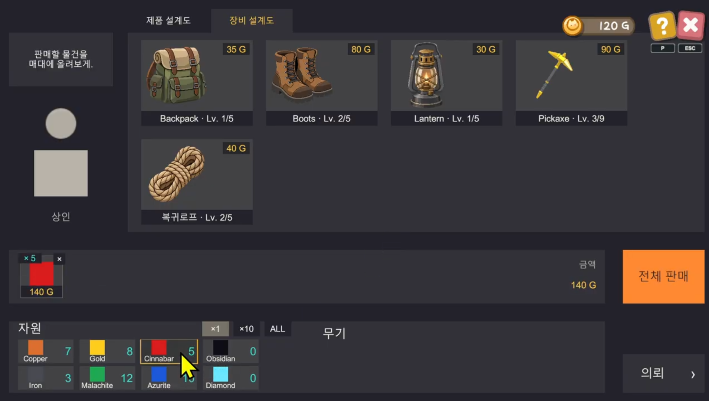

<!-- HERO (centered only at the top) -->
<h1 align="center">DeepForge</h1>
<p align="center"><em>땅을 파고, 재료를 모으고, 나만의 장비를 만드는 3D 채굴 · 제작 성장 게임</em></p>


DeepForge 플레이 영상과 스크린샷이 준비되면 아래 블록의 주석을 해제하고
VIDEO_ID와 이미지 경로를 실제 자료로 교체하세요.

<p align="center">
  <a href= "https://www.youtube.com/watch?v=HmuJPvc80IY">
    
  </a>
</p>

<table width="100%">
  <tr>
    <td width="33.33%" align="center" valign="middle">
      
    </td>
    <td width="33.33%" align="center" valign="middle">
      
    </td>
    <td width="33.33%" align="center" valign="middle">
      
    </td>
  </tr>
</table>


---

## About the Game

**DeepForge**는 지형을 직접 파내며 광산을 탐험하고, 수집한 광물을 장비 제작과 강화에 활용하는 **3D 채굴 · 제작 성장 게임**입니다.

플레이어는 곡괭이로 지형을 깎아 이동 경로를 만들고, 광석에서 얻은 자원을 배낭에 담아 기지로 운반합니다. 기지에서는 광물을 판매하거나 대장간에서 재료를 조합해 무기와 도구를 제작하고, 상점의 주문 조건에 맞는 제작품을 납품할 수 있습니다.

채굴과 제작으로 얻은 재화를 설계도 구매와 탐사 장비 강화에 투자해, 더 많은 자원을 운반하고 더 깊은 곳까지 탐험하는 것이 핵심 성장 흐름입니다.

## Features

- **실시간 지형 채굴**: 조준한 위치의 지형을 깎아 통로를 만들고, 드러난 광석을 수집
- **절차적 광산 생성**: 지형과 동굴 통로를 생성하고, 깊이에 따른 지층별 광석 후보를 배치
- **배낭과 자원 운반**: 배낭 용량 안에서 광물을 수집하고, 기지에서 보관 재고로 이동
- **로프 복귀 시스템**: 이동 경로를 기록해 기지 방향으로 복귀하며, 로프 길이에 따라 탐사 거리 제한
- **재료 조합 제작**: 손잡이와 금속 재료, 보석 사용 여부를 선택해 무기·방패·도구를 제작하고, 재료와 제작 레벨에 따라 판매 가격 계산
- **대장간 작업 슬롯**: 4개의 슬롯에서 제작과 탐사 장비 강화를 진행하고, 완료된 작업을 수령
- **상점과 주문 납품**: 광물과 제작품을 판매하거나, 품목·재료·보석 조건과 요구 수량을 충족하는 제작품을 납품해 보상 획득
- **설계도 기반 성장**: 재화로 다음 단계 설계도를 해금하고, 필요한 광물을 소모해 탐사 장비 강화
- **진행 및 월드 저장**: 재고, 배낭, 강화 단계, 주문, 제작 작업과 함께 변경된 지형 및 광석 수집 상태를 저장
- **사운드와 시각 피드백**: 채굴 타격, 광석 수집, 로프 복귀, 제작·거래 효과음과 파티클·UI 애니메이션 적용

## Progression

**광산 탐험 → 지형 채굴 · 광물 수집 → 기지 복귀 → 제작 · 판매 · 주문 납품 → 설계도 구매 · 장비 강화 → 탐사 범위 확장**

- **곡괭이 강화**: 채굴력과 채굴 범위를 높여 지형을 파내는 능력 향상
- **배낭 강화**: 적재 용량을 늘려 한 번의 탐사에서 운반할 수 있는 광물 수량 증가
- **장화 강화**: 이동 속도와 점프 횟수를 높이고, 강화 단계에 따라 대시를 해금해 기동성 향상
- **랜턴 강화**: 조명 범위를 넓혀 어두운 광산의 시야 확보
- **복귀 로프 강화**: 로프 길이를 늘려 기지에서 더 먼 곳까지 탐험
- **제작 설계도 해금**: 제작 가능한 레벨을 높이고, 재료 조합과 주문 조건을 고려해 제작품 선택

## Technical Highlights

- **밀도 필드 기반 지형 변형**: 지형 밀도 데이터를 수정하고 Marching Cubes로 표면 메시를 생성해 채굴 결과를 지형에 반영
- **청크 단위 스트리밍**: 플레이어 주변 청크를 거리순으로 활성화하고, 프레임당 활성화 수를 제한해 로딩 작업을 분산
- **Job System · Burst 활용**: 지형 밀도 처리와 청크 메시 생성을 Job으로 구성하고 Burst 컴파일 적용
- **월드 변경분 저장**: 변경된 청크를 Region 단위로 묶어 저장하고, 밀도 데이터 인코딩과 광석 상태 비트 마스크로 탐사 결과를 복원
- **데이터와 런타임 상태 분리**: ScriptableObject에 광물·제작품·강화 정의를 두고, 보유 재고·해금 단계·최종 능력치를 별도 관리
- **조합별 제작품 아이콘**: 선택한 재료를 제작품 모델에 반영해 아이콘을 생성하고 인벤토리와 제작 UI에 표시

## Controls

| 입력 | 동작 |
| --- | --- |
| `W` `A` `S` `D` / 방향키 | 이동 |
| 마우스 이동 | 시점 회전 |
| 마우스 왼쪽 버튼 | 지형 채굴 · 광석 수집 |
| `Space` | 점프 |
| `Left Shift` | 대시 (장화 강화로 해금) |
| `G` | 로프 복귀 |
| `C` | 채굴 모드 / 커서 모드 전환 |

## Tech Stack

| 구분 | 기술 |
| --- | --- |
| 엔진 | Unity 6 (`6000.3.7f1`) |
| 언어 | C# |
| 렌더링 | Universal Render Pipeline (URP) |
| 입력 | Unity Input System |
| 지형 처리 | Marching Cubes, Unity Job System, Burst, Mathematics |
| UI · 연출 | Unity UI, TextMeshPro, DOTween |
| 저장 | JSON 기반 게임 진행 저장, 바이너리 기반 월드 Region 저장 |

## Project Structure

```text
Assets/Scripts
├── Audios          # 오디오 데이터 정의
├── Datas           # 광물, 장비, 제작품, 지형, 강화 SO 및 저장 DTO
├── DBs             # Resources 기반 데이터 조회
├── Managers        # 게임, 입력, 재고, 강화 관리
│   ├── BaseCamp    # 대장간, 주문, 제작품 아이콘 생성
│   ├── GameLoop    # 배낭 및 채굴 자원 관리
│   └── Utility     # 게임·월드 저장, 오디오, 튜토리얼, 알림
├── Math            # 3D 노이즈 계산
├── Orders          # 주문 데이터 및 품목·재료·보석 조건 판정
├── Players         # 이동, 카메라, 채굴, 로프 복귀
├── Pools           # 오브젝트 및 광석 풀링
├── Scenes          # 씬 초기화, 전환, 광산 조명
├── Stocks          # 재고, 제작품, 대장간 작업 슬롯 데이터
├── Stones          # 광석 동작, 표현 및 생성 데이터
├── Terrain         # 지형 생성 및 채굴 처리
│   ├── Cave        # 동굴 통로 생성
│   ├── Chunk       # 청크 등록, 관리, 스트리밍
│   ├── Density     # 밀도 필드 생성 및 변형 Job
│   └── Mesh        # Marching Cubes 및 청크 메시 생성
├── UIs             # 탐사 HUD, 기지, 대장간, 상점, 설정 UI
└── UpgradeSys      # 강화 상태, 런타임 레벨 및 장비 능력치 계산
```
